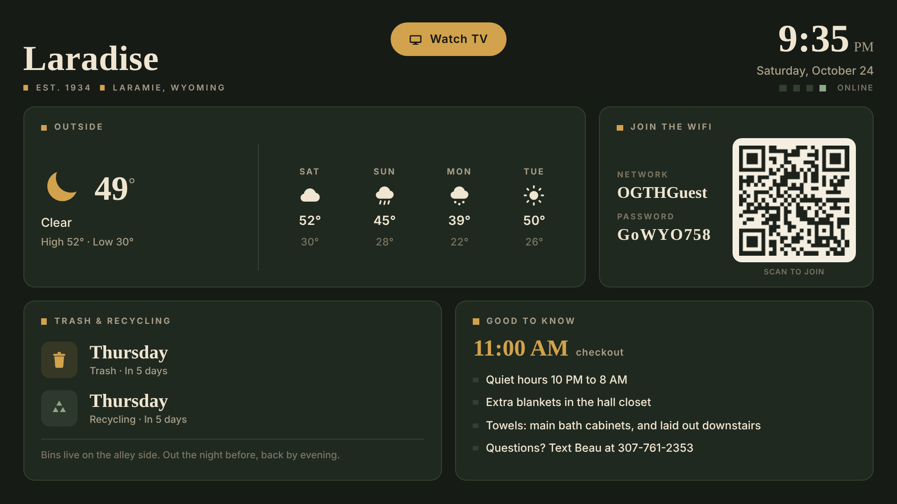

# Laradise dashboard

The Laradise guest page full screen on the bar TV: the clock, the Laramie forecast, the guest Wi-Fi
with a QR code to join, trash days and house notes. A **Watch TV** button, where the remote starts,
goes to the Clean Your TV home screen.



- The page ships inside the app (`app/src/main/assets/index.html`), QR library included, so it shows
  even when the internet is down. The forecast comes from Open-Meteo (no key) every 30 minutes.
- The thermostat card is hidden until Home Assistant is connected: set `token` (and `haUrl`, e.g.
  `http://192.168.1.50:8123`) in the page's `CONFIG`. Use a token from a Home Assistant user that can't
  reach locks or anything else you'd mind a guest controlling: the token is readable in the page.
- The screen stays on while the dashboard is in front. Back or Watch TV goes Home; reopening the tile
  reloads; Menu reloads where the remote has one.

To change the Wi-Fi, notes, checkout time or trash days, edit `CONFIG` near the top of the script in
`index.html`, then build and install again.

## Install on the bar onn box

From a checkout of this branch on the Crimson mini PC, with adb already connected to the box over
Tailscale (`adb connect 100.74.181.47:5555`):

```bash
python3 -m venv tools/venv && tools/venv/bin/pip install -r tools/requirements.txt
export TV_HOST=100.74.181.47
export JAVA_HOME=~/.local/android-build/jdk-17.0.21+9 ANDROID_HOME=~/.local/android-build/sdk

# 1. The Clean Your TV launcher (replaces the tv-vibehack one, same package, so it upgrades in place).
#    The script refuses to disable setupwraith while it owns the saved Wi-Fi network: that would take
#    the box off Wi-Fi and Tailscale. If it stops there, forget and re-join the Wi-Fi on the box first.
STOCK_LAUNCHER=com.google.android.apps.tv.launcherx launcher/build-and-install.sh

#    If pm install answers INSTALL_FAILED_UPDATE_INCOMPATIBLE (the old launcher was signed with another
#    key), run  tools/venv/bin/python -I tools/tv.py 'pm uninstall com.gathin.tvhome'  and this step again.

# 2. This dashboard.
(cd addons/laradise-dashboard && echo "sdk.dir=$ANDROID_HOME" > local.properties && ./gradlew assembleRelease)
tools/venv/bin/python -I tools/b64push.py addons/laradise-dashboard/app/build/outputs/apk/release/app-release.apk /data/local/tmp/laradise.apk
tools/venv/bin/python -I tools/tv.py 'pm install -r /data/local/tmp/laradise.apk; rm -f /data/local/tmp/laradise.apk'
```

Then on the TV: answer **Show** when the launcher asks about the Laradise card, and set Launcher
settings → **Open on start** → Laradise so the dashboard comes up after every boot.
