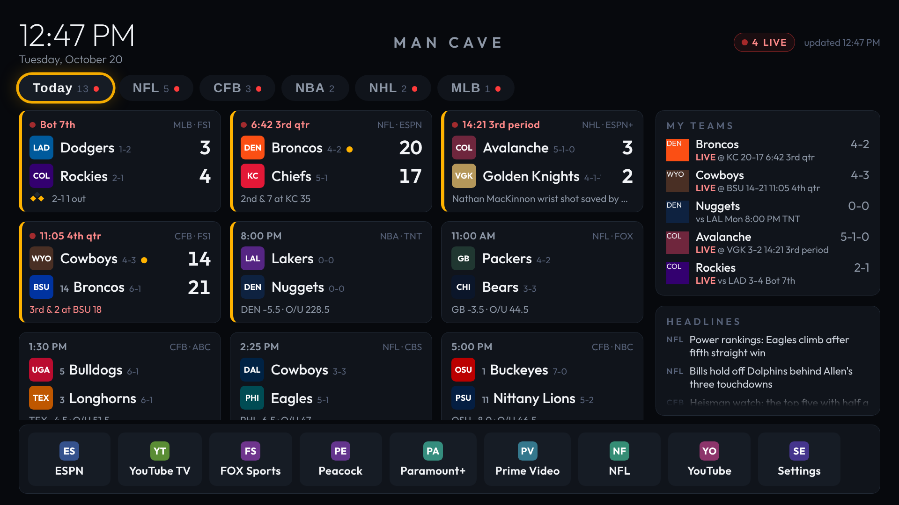
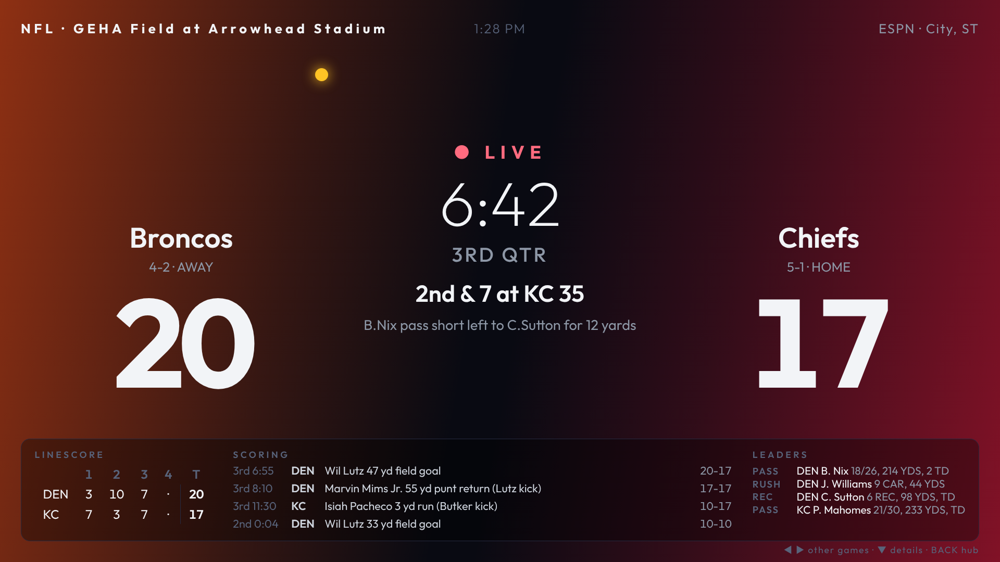
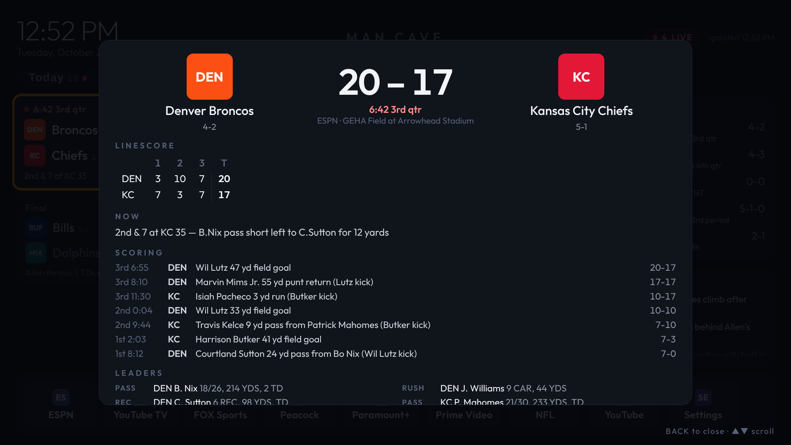

# Sports Hub

A live-scores home screen for a Google TV stick in the man cave. One Python file on a mini PC
pulls scores, situations, odds, standings and headlines from ESPN; the stick shows them full-screen
and boots straight into it. Pick a game for the linescore, scoring plays and leaders; pick an app in
the dock to jump into ESPN, YouTube TV, FOX Sports, or whatever you subscribe to.

<p align="center">
  
</p>

| Game mode board (OK on a live card) | Game detail (OK on a finished or upcoming card) |
|---|---|
|  |  |

Built for a TV viewed from across the room: dark background, large type, one focus ring, D-pad only.
Everything is in `rem` with `1rem = 1/120 of the screen width`, so it looks the same at 1080p and 4K.
The screenshots are from demo mode in a sandbox without internet, so they show team abbreviations
where the real page shows ESPN's team logos.

## Parts

| Path | What it is |
|---|---|
| `server.py` | Stdlib-only Python server: serves the page, proxies and caches ESPN, normalises the data. |
| `config.json` | Leagues, favourite teams, dock apps, refresh rates, timezone, fantasy hook. |
| `static/` | The page: `index.html`, `style.css`, `app.js`, the Outfit font. No build step. |
| `android/` | A 100 KB kiosk app (WebView) that makes the page the stick's home screen. |
| `demo/` | ESPN-shaped fixtures so you can develop without hitting ESPN (`--demo`). |
| `sportshub.service` | systemd unit for the mini PC. |
| `../examples/onn-4k-streaming-stick/debloat.txt` | What to disable on the stick. |

## Quick start

### 1. Mini PC: run the server

```bash
cd sportshub
python3 server.py                 # http://0.0.0.0:8777/
```

Python 3.9 or newer, nothing to install. Open `http://<pc-ip>:8777/` in any browser on the LAN and
drive it with the arrow keys and Enter to check it before touching the stick. Edit `config.json`
first if you want different leagues or teams (see [Configuration](#configuration)).

To keep it running, see [Running as a service](#running-as-a-service).

### 2. Stick: developer mode and ADB

On the stick: Settings → System → About → press OK on **Android TV OS build** seven times, then
Settings → System → Developer options → **USB debugging** on (and **Wireless debugging** if shown).
Note the stick's IP under Settings → Network. Then from the repo root:

```bash
python3 -m venv tools/venv && tools/venv/bin/pip install -r tools/requirements.txt
export TV_HOST=192.168.1.60                         # the stick
tools/venv/bin/python -I tools/tv.py --probe       # accept "Allow USB debugging?" on the TV
```

### 3. Stick: back up, then debloat

```bash
mkdir -p backup && tools/venv/bin/python -I tools/tv.py 'pm list packages' > backup/packages.txt
tools/venv/bin/python -I tools/tv.py 'pm list packages -d' > backup/disabled.txt
tools/disable.sh examples/onn-4k-streaming-stick/debloat.txt
```

Read the header of that list first: it was composed from the Google TV package set and still needs
checking against a real stick. Comment out anything you use. Undo any time with
`tools/restore.sh examples/onn-4k-streaming-stick/debloat.txt com.google.android.apps.tv.launcherx`.

### 4. Stick: make the hub the home screen

**Option A, the kiosk app (recommended).** Needs JDK 17 and the Android SDK on your computer, same
as `launcher/` (macOS: `brew install openjdk@17 android-commandlinetools && sdkmanager
"platforms;android-34" "build-tools;34.0.0"`).

```bash
TV_HOST=192.168.1.60 HUB_URL=http://192.168.1.50:8777/ sportshub/android/build-and-install.sh
```

That builds the APK, pushes it over ADB, sets it as the home activity, disables Google TV Home and
starts it. Press Home on the remote and you are in the hub. Hardware Back closes the game overlay
or returns to Today; it never exits, because this *is* the home screen. If the server is down the
app shows an offline page with the URL it tried; OK retries. To change the URL later without a
rebuild:

```bash
tools/venv/bin/python -I tools/tv.py 'am start -n com.sportshub.tv/.MainActivity --es url http://192.168.1.50:8777/'
```

Set `KEEP_STOCK_HOME=1` to install the app without disabling Google TV Home (it then appears in
the apps row as "Sports Hub"). The kiosk app has not yet been built against a real stick in this
repo's history: if `gradlew` or the first install trips on something, open an issue with the output.

**Option B, no build.** Sideload [Projectivy Launcher](https://play.google.com/store/apps/details?id=com.spocky.projengmenu)
as the home screen and [Fully Kiosk Browser](https://www.fully-kiosk.com/) (or any TV browser)
pointed at `http://<pc-ip>:8777/`, pinned as the first tile. The dock still works: with no kiosk
bridge the page launches apps through `intent://` URLs, which Fully Kiosk and Chrome-based
browsers honour. You lose the Back/Home handling and the offline page.

## Using it

| Remote | Does |
|---|---|
| ▲ ▼ ◀ ▶ | Move the focus ring between the league tabs, the game cards and the dock. Sideways moves stay in the row. |
| OK | On a tab: show that league. On a card: open the game (linescore, scoring, leaders, team stats). On a dock tile: launch the app. |
| Back | Close the overlay, else return to Today. |
| 1–9 | Jump to the n-th tab. |
| Play/Pause | Refresh now. |

The **Today** tab merges every league, with your favourites first, then live games, then upcoming,
then finals. Favourites get a gold edge. Live cards show the clock, possession (●), down and
distance, red-zone alerts, runners on base, or the last play. Upcoming cards show the line and
over/under; finals show the headline. The **My Teams** rail shows record, standing and the next or
current game for each favourite.

**Hands-off mode.** After `idleAfterSeconds` without a key press the hub drives itself: the score
grid pages upward one row-band every `idleScrollSeconds`, and when it reaches the bottom the next
league tab comes up (`idleRotateSeconds` is the dwell on a tab that fits on one screen). The first
arrow press afterwards lands on a visible card. Scores refresh every `liveSeconds` while any game
is in progress, else every `idleSeconds`. If ESPN stops answering, the last good data stays on
screen with an "OFFLINE · cached" pill; nothing goes blank.

## Game mode: the board

OK on a live card opens a full-screen scoreboard in the two teams' colours: logos, scores at 15rem,
clock and period, down and distance or runners on base, possession dot, timeouts, a red-zone pulse
on the side with the ball, and along the bottom the linescore, the last four scoring plays and the
stat leaders. ◀ ▶ flips between live games, ▼ opens the detail overlay, Back returns to the hub.

It also takes over on its own. When a favourite is playing and the remote has been idle for
`gameMode.idleSeconds`, the hub switches to the board for that game and stays until
`exitAfterFinalSeconds` after the final, then returns to the hub (or to the next live favourite).
**Favourites are a priority list**: the order in `config.json` decides which game the board shows
when two favourites are live at once, and it switches up to a higher-priority game if one starts.
Set `gameMode.rotateSeconds` above 0 to cycle through all live favourites instead.

```json
"favorites": [
  {"league": "cfb", "team": "wyo"},
  {"league": "nfl", "team": "buf", "sound": "sounds/bills.mp3"},
  {"league": "nhl", "team": "col"},
  {"league": "nhl", "team": "buf"}
],
"gameMode": {"auto": true, "idleSeconds": 60, "rotateSeconds": 0, "refreshSeconds": 15,
             "exitAfterFinalSeconds": 120, "callouts": true, "sound": ""}
```

**Score callouts.** Whenever a favourite's game changes score (or any game while its board is up)
the screen flashes a banner in the scoring team's colour: TOUCHDOWN / FIELD GOAL / SAFETY, GOAL,
RUN SCORES / GRAND SLAM, with a sport-specific animation (a tumbling football, a goal lamp and a
sliding puck, a ball arcing out of the park, a rolling soccer ball) and confetti in the team's
colours. Basketball is left quiet because it scores every 20 seconds. If you want a horn, drop an
audio file under `static/sounds/` (git-ignored) and name it per favourite with `sound`, or once for
all of them with `gameMode.sound`. The kiosk app allows autoplay; a plain browser may not.

To see a callout without waiting for a game, open the browser console on the page and run
`SportsHubPage.simulateScore("nfl", "<game id>", "away", 7)`.

## Configuration

`config.json`, restart the server after editing.

```jsonc
{
  "title": "Man Cave",
  "timezone": "America/Denver",           // all times on the page are shown in this zone
  "leagues": [                            // order = tab order
    {"key": "nfl", "label": "NFL", "sport": "football", "league": "nfl"},
    {"key": "cfb", "label": "CFB", "sport": "football", "league": "college-football",
     "params": {"groups": "80"}}          // 80 = all FBS; use a conference id (e.g. 8 = SEC, 17 = MWC) to narrow
  ],
  "favorites": [{"league": "nfl", "team": "den"}],   // ESPN team abbreviation per league key
  "apps": [{"label": "ESPN", "package": "com.espn.score_center"}],
  "refresh": {"liveSeconds": 30, "idleSeconds": 300, "cacheSeconds": 20},
  "idleAfterSeconds": 30, "idleScrollSeconds": 7, "idleRotateSeconds": 20,
  "showOdds": true,
  "gameMode": {"auto": true, "idleSeconds": 60},
  "fantasy": {"enabled": false}
}
```

- **Leagues.** `sport/league` is ESPN's path: `football/nfl`, `football/college-football`,
  `basketball/nba`, `basketball/mens-college-basketball`, `basketball/wnba`, `hockey/nhl`,
  `baseball/mlb`, `soccer/usa.1` (MLS), `soccer/eng.1` (Premier League), `golf/pga`… `params` are
  passed straight through (`groups` for conferences, `limit`). Set `"news": false` on a league to
  keep it out of the headlines.
- **Favourites.** `team` is the abbreviation ESPN uses in its URLs (`den`, `kc`, `wyo`, `col`).
  For college teams the numeric id also works. The defaults are a Wyoming/Colorado guess, change them.
- **Apps.** `package` names: `tools/tv.py 'pm list packages'` on the stick. Leave `apps` empty when
  using the kiosk app and the dock fills itself with every installed TV app, alphabetically. A
  `color` (`"#1d9bf0"`) overrides the generated tile colour.

### Theme

```json
"theme": {"preset": "wyo-bills"}
```

Presets: `default` (neutral dark, amber focus ring), `wyoming` (brown and gold), `bills` (royal
blue and red), `wyo-bills` (gold focus ring and favourite edges, Bills blue active tab, Bills red
live indicators, both logos beside the title). Any colour can be overridden next to the preset:

```json
"theme": {"preset": "wyo-bills", "title": "#ffffff", "logos": ["https://a.espncdn.com/i/teamlogos/ncaa/500/2751.png"]}
```

Keys: `accent` (focus ring, favourite edge), `accent2` / `accent2Fg` (active tab), `live` /
`liveText`, `bg`, `panel`, `panel2`, `line`, `title`, `text`, `muted`, `dim`, `gradient` (any CSS
background-image), `logos` (up to two image URLs flanking the title). ESPN logo URLs follow
`https://a.espncdn.com/i/teamlogos/{nfl|nba|nhl|mlb|ncaa}/500/{abbr or college id}.png`.

### Fantasy hook

If you already have a script that knows your fantasy league (the `ff.py` on the mini PC that logs
into ESPN Fantasy), you can put its output in the rail without teaching this server anything
about ESPN's fantasy auth. Enable it and point at either a command or a URL that returns JSON:

```json
"fantasy": {"enabled": true, "title": "Gillette League", "command": "python3 /home/beau/ff/ff.py --hub-json",
            "cwd": "/home/beau/ff", "cacheSeconds": 120, "timeoutSeconds": 30}
```

Expected output, either or both keys:

```json
{"title": "Week 7", "rows": [{"label": "Beau vs Ryan", "value": "88.4 – 71.2", "sub": "proj 112–104"}],
 "lines": ["Nix 24.6  ·  Sutton 18.2"]}
```

`rows` render as label / value pairs, `lines` as plain text; the first six of each show. Add a
`--hub-json` flag to `ff.py` that prints that shape and you are done. The server caches the result,
so the script runs at most once per `cacheSeconds`.

## Running as a service

**Linux (systemd), from the git checkout** so `git pull` picks up fixes:

```bash
sudo cp sportshub/sportshub.service /etc/systemd/system/
sudo sed -i "s#/opt/sportshub#$PWD/sportshub#g; s/^DynamicUser=yes/User=$USER/; /^ProtectHome=yes/d" /etc/systemd/system/sportshub.service
sudo systemctl daemon-reload && sudo systemctl enable --now sportshub
journalctl -u sportshub -f
```

Or copy it to `/opt/sportshub` and install the unit unchanged; it then runs as a locked-down dynamic
user, which is fine unless the fantasy hook needs to read files in your home directory.

**Windows mini PC:** create a Scheduled Task that runs at logon:
`pythonw.exe C:\sportshub\server.py --config C:\sportshub\config.json`, or use NSSM to wrap it as a
service. Allow TCP 8777 through Windows Firewall for the private network.

Give the mini PC a DHCP reservation so the URL in the stick never changes.

## API

Everything the page uses is plain JSON you can reuse elsewhere (a phone, Home Assistant):

| Endpoint | Returns |
|---|---|
| `/api/today` | Every configured league's games for today, normalised and sorted. |
| `/api/scoreboard?league=nfl&date=20261020` | One league, optionally another day. |
| `/api/myteams` | Record, standing, next game for each favourite. |
| `/api/news` or `/api/news?league=nfl` | Headlines. |
| `/api/game?league=nfl&id=401…` | Scoring plays, leaders, team stats, win probability for one game. |
| `/api/fantasy` | Output of the fantasy hook. |
| `/api/health` | Cache state and the last upstream error per key. |

ESPN's `site.api.espn.com` is unofficial and has no auth; be a good neighbour and keep
`cacheSeconds` at 15 or more. The server never calls it more often than that per league, no matter
how many screens are open.

## Development

```bash
python3 server.py --demo -v        # fixtures from demo/, no network
python3 -I demo/make_fixtures.py   # regenerate the fixtures after editing the generator
```

Demo mode has a live NFL game with a red-zone drive, a college game with ranks, a baseball game with
runners on, an overtime final, odds on the upcoming games, plus team pages and headlines, which
covers every branch the page renders. Open `http://localhost:8777/` and use the arrow keys.
